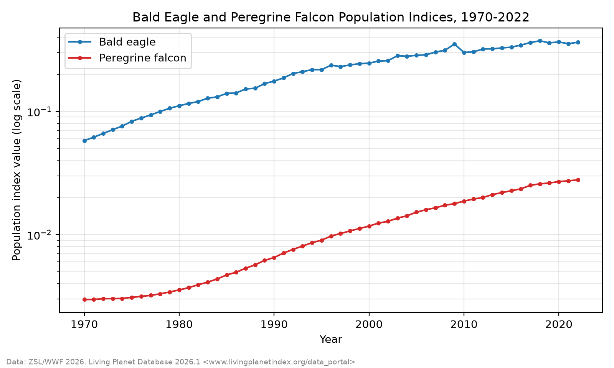
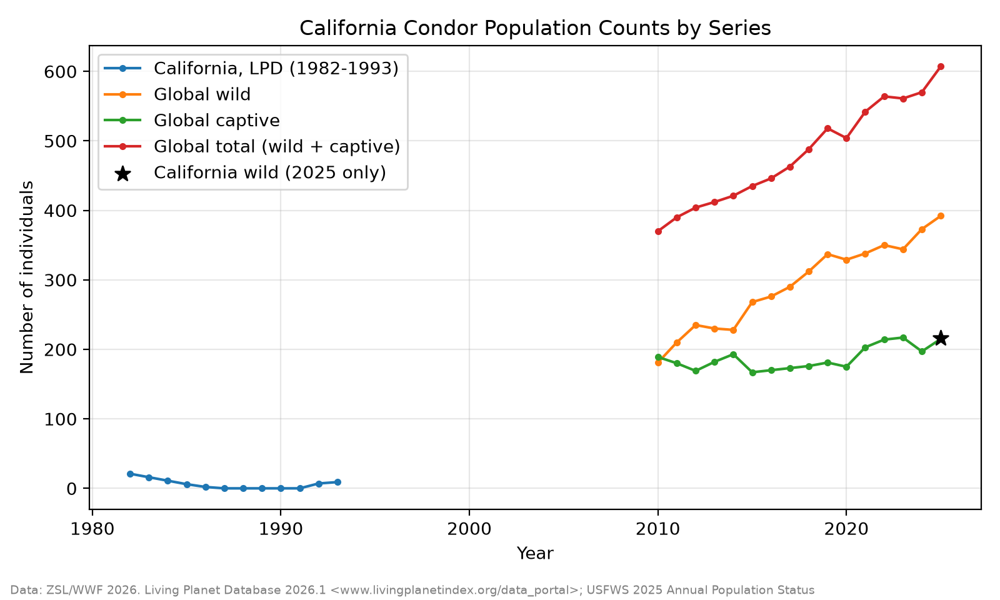

# DATA: Metadata

This folder holds the data for the birds-of-prey population project: the initial data, the intermediate and analysis-ready (final) datasets, and the explanatory plots below. The scripts in `SCRIPTS/` turn the initial data into the final data; see the top-level `README.md` for the order to run them.

## Data Summary

The data was downloaded in CSV format from the Living Planet Index and the U.S. Fish and Wildlife Service (USFWS), from their publicly available data tables and census reports that detail annual bird populations since the 1970s. We queried the data in Claude to extract the population values for our 3 species: bald eagle, California condor, and peregrine falcon. We then consolidated the data for the 3 birds into a single CSV file (`birds_consolidated.csv`) and cleaned it into the series used for modelling.

| Dataset | What it contains | Records used | Years | Size |
|---|---|---|---|---|
| **Living Planet Database (LPD) 2026.1, public** | 37,040 vertebrate population time series (one row per series, one column per year), compiled by ZSL and WWF | 3 series: bald eagle (ID 2910), peregrine falcon (ID 28210), California condor (ID 3328) | 1950-2022 (columns); the series used cover 1970-2022 and 1982-1993 | ~34 MB CSV, 104 columns |
| **USFWS California Condor Recovery Program annual population status reports** | Condor counts: global wild, captive and total populations; year-end counts of wild condors by flock; deaths in the wild by flock | Global series, California wild flock, Arizona/Utah wild flock | 2010-2025 | Typed in from the reports |

**What each series measures**

| Series | Species | Area | Units | Role in the analysis |
|---|---|---|---|---|
| LPD 2910 | Bald eagle | United States + Canada | Breeding Bird Survey relative abundance index (not a bird count) | Modelled: interrupted time series (break at 2007 delisting) and forecasts |
| LPD 28210 | Peregrine falcon | North America (US + Canada) | Breeding Bird Survey relative abundance index (not a bird count) | Modelled: interrupted time series (break at 1999 delisting) and forecasts |
| LPD 3328 | California condor | California | Number of wild individuals | Descriptive only: the 1982-1987 collapse and 1992 reintroduction |
| USFWS-GLOBAL-WILD, -CAPTIVE, -TOTAL | California condor | Global wild, captive, and total populations | Number of individuals | Exploration only (see the condor plot); not modelled |
| USFWS-CA-WILD | California condor | California wild flock (Southern + Central CA) | Wild individuals at year-end (Dec 31) | Modelled: comparison around the 2019 statewide lead ammunition ban, and forecasts |
| USFWS-AZUT-WILD | California condor | Arizona/Utah wild flock | Wild individuals at year-end (Dec 31) | Comparison flock (no mandatory lead ban), and forecasts |
| USFWS-CA-WILD-DEATHS, USFWS-AZUT-WILD-DEATHS | California condor | Same flocks | Deaths in the wild during the year | Secondary outcome (collected, not yet modelled) |

Counts are reported either as index values or as numbers of individuals, as recorded in the `units` column, so counts should not be compared directly across series with different units.

**Important limitations**

- The California flock series has only **6 yearly counts** (2012, 2016, 2017, 2020, 2024, 2025). Other years appear only in report copies hosted by third parties and were deliberately left out; no years are imputed.
- The bald eagle and peregrine series are model-based indices from the North American Breeding Bird Survey; they show relative change, not numbers of birds.
- Bald eagle 2009 (index 0.352, above both 2008 and 2010) is flagged as an outlier (`outlier_flag`), not removed.

## Provenance

**Living Planet Database**

- Downloaded on 10/15/2026 from the LPI Data Portal [2] as the public CSV (`LPD_2026.1_public.csv`).
- **The raw file is not included in this repository**, because the LPI Data Use Policy [3] does not allow publishing it in its original format. To obtain it:
  1. Go to the [LPI Data Portal](https://www.livingplanetindex.org/data_portal).
  2. Register with your name and email, describe how you will use the data, and accept the data use policy.
  3. Download the public dataset (version 2026.1) as a CSV.
  4. Rename it to `LPD_public.csv` and save it in this `DATA/` folder. The scripts read it from `DATA/LPD_public.csv`.
- Original sources of the records used, as given in the LPD:
  - 2910 and 28210: the North American Breeding Bird Survey analysis results [4].
  - 3328: Pattee and Mesta, "California condors" [5].
- `peregrine_falcon_28210_cleaned.csv` holds record 28210 in long format, as extracted during data collection; `03_combine_data.py` reads it directly.

**USFWS condor counts**

- The global wild, captive and total counts (2010-2025) and the single 2025 California wild count come from the 2025 Annual Population Status report [6]. They were extracted, together with LPD record 3328, into `california_condor_long.csv`.
- The yearly California and Arizona/Utah flock counts and deaths were typed in by hand from the reports below by `05_build_condor_flocks.py`, which lists every value next to its report and page. Each row of `usfws_condor_flocks.csv` records its exact report, page and figure in the `source_detail` column. Only official copies were used (fws.gov, ecos.fws.gov, and the 2017 report as hosted by the California Department of Fish and Wildlife). When two official reports disagreed, the most recent was used and the other value noted.

| Report | Used for | Reference |
|---|---|---|
| 2025 Annual Population Status (as of Dec 31, 2025) | Global series 2010-2025; AZ/UT flock 2012-2025 (p.11 chart); CA flock 2025; deaths 2023-2025 | [6] |
| 2024 Annual Population Status | CA flock 2024 | [7] |
| 2020 Annual Population Status | CA flock 2020; deaths 2019-2020 | [8] |
| 2017 Annual Population Status (hosted by CDFW) | CA flock 2016-2017; deaths 2017 | [9] |
| California Condor 5-Year Review (June 2013) | CA flock 2012 | [10] |

The report PDFs are linked rather than stored here, as the Department of the Interior asks.

**Processing** (initial to final; details in the script headers in `SCRIPTS/`)

1. Select the three LPD records by ID and reshape them from wide (one column per year) to long (one row per year); drop years with no value (`02_prepare_data.py`).
2. Combine the bald eagle, peregrine falcon and condor files into `birds_consolidated.csv` (`03_combine_data.py`).
3. Split by source and compute `log_count` = ln(count), left blank where count = 0 (condor 3328, 1987-1991) with `zero_count` set; flag the bald eagle 2009 outlier (`04_clean_data.py`).
4. Build the USFWS flock file from the typed-in report values (`05_build_condor_flocks.py`).
5. Add the segmented-regression variables (`time`, `after`, `time_after`, and the flock comparison terms) (`07_make_model_vars.py`).

No values are imputed, and series with different IDs, units or locations are never combined.

## License

- **LPD data** are used under the LPI Data Use Policy [3]. Downloading requires a name, email, and a description of how the data will be used. The policy allows use for conservation, scientific analysis or research only, not for commercial purposes or financial gain; the data are not to be passed to third parties or published in their original format, and derived data are covered by the same terms. Figures and tables derived from the LPD carry the citation [2].
- **USFWS data** are US government works and in the public domain. The only requirement is to credit the source, which the `source` and `source_detail` columns do.
- The project's own code and documentation are covered by the repository's `LICENSE.md` (MIT).

## Ethical Statements

- **Lawful collection.** No illegal barriers were surpassed to extract the data.
- **No human subjects or personal data.** The data are counts and indices of wild bird populations.
- **Not a guide for poaching.** The results are not intended to help hunters use gaps in population monitoring to find windows for hunting. There is a black market for many of these birds of prey [1], and pointing out gaps in surveillance of these species may make them vulnerable.
- **No sensitive locations.** All series are aggregated to state, flock or continental level; no nest or roost locations are used or published. This matters for the California condor, which is endangered.
- **Data owners' terms.** USFWS reports were used only from official copies; copies hosted by third parties were excluded because they could not be verified against the originals.
- **Honest limits.** The small California flock series (6 counts), the index nature of the Breeding Bird Survey series, and the outlier flag are reported rather than hidden, and no missing years are filled in.
- **Acknowledgement.** As the LPI policy requests, a copy of the final products should be sent to LivingPlanetIndex@ioz.ac.uk.

## Data Dictionary

### Initial: `LPD_public.csv` (not included; see Provenance for the download steps)

One row per population time series. Missing values are written as `NULL`. Only the columns used by the scripts are listed.

| Variable | Type | Description | Units / allowed values |
|---|---|---|---|
| `ID` | integer | LPD record ID | e.g. 2910, 28210, 3328 |
| `Binomial` | text | Scientific name with underscores | e.g. `Haliaeetus_leucocephalus` |
| `Common_name` | text | Common species name | e.g. Bald eagle |
| `Location` | text | Area the series covers | free text |
| `Country` | text | Main country listed | country name |
| `All_countries` | text | All countries the series covers | comma-separated country names |
| `Units` | text | What the yearly values measure | free text |
| `Citation` | text | Original data source | free text |
| `1950` ... `2022` | number | Value for that year | in `Units`; `NULL` = no data |

### Initial: `california_condor_long.csv`

| Variable | Type | Description | Units / allowed values |
|---|---|---|---|
| `Year` | integer | Year of the count | 1982-2025 |
| `Series` | text | Population group | e.g. Global wild free-flying population (CA, AZ/UT, PNW, Baja) |
| `Value` | number | Count | number of individuals |
| `Units` | text | What `Value` measures | Number of individuals |
| `ID` | text | Series identifier | `3328`, `USFWS-CA-WILD`, `USFWS-GLOBAL-WILD`, `USFWS-GLOBAL-CAPTIVE`, `USFWS-GLOBAL-TOTAL` |
| `Source` | text | Where the value came from | LPD file or USFWS 2025 report |

### Consolidated: `birds_consolidated.csv`

167 rows. `birds_cleaned.csv` and `bald_eagle_cleaned.csv` use the same columns; `peregrine_falcon_28210_cleaned.csv` has the first seven.

| Variable | Data Type | Description | Values / Range |
|---|---|---|---|
| `species` | Text (categorical) | Common name of the bird species. | Bald eagle, California condor, Peregrine falcon (3 unique) |
| `ID` | Text (identifier) | Identifier for the population time series. Numeric IDs are Living Planet Database series IDs; IDs beginning with "USFWS" are labels for U.S. Fish and Wildlife Service series. | 2910, 3328, 28210, USFWS-CA-WILD, USFWS-GLOBAL-CAPTIVE, USFWS-GLOBAL-TOTAL, USFWS-GLOBAL-WILD (7 unique) |
| `location` | Text (categorical) | Geographic area and population group the series covers. | United States and Canada; North America; California; California wild (Southern + Central CA flocks), 2025 only; Global captive population; Global total population (wild + captive); Global wild free-flying population (CA, AZ/UT, PNW, Baja) |
| `units` | Text (categorical) | Unit in which count is measured. | "Index values" (relative abundance) or "Number of individuals" (actual counts) |
| `year` | Integer | Calendar year of the observation. | 1970 to 2025 |
| `count` | Numeric (decimal) | Population measure for that series and year. Meaning depends on units: an index value or a number of birds. | Index values: 0.00297 to 0.374. Number of individuals: 0 to 607 |
| `log_count` | Numeric (decimal) | Natural log of count. Uses ln(count) for series with no zeros and ln(count + 1) for series that contain zeros (record 3328), as recorded in `log_transform`. | about -5.82 to 6.41 |
| `log_transform` | Text (categorical) | Which transform was used for `log_count`. | "log(count)" (155 rows) or "log(count + 1)" (12 rows, record 3328) |
| `source` | Text (categorical) | Origin of the data. | Living Planet Database 2026.1; Living Planet Database (LPD_2026_1_public.csv); USFWS 2025 Annual Population Status (PDF) |

### Final long-format series: `lpd_series.csv`, `usfws_condor.csv`, `usfws_condor_flocks.csv`

`lpd_series.csv` holds the three LPD records, `usfws_condor.csv` the USFWS global and 2025 California series, and `usfws_condor_flocks.csv` the yearly flock counts and deaths. All three share these columns; the flock file adds `source_detail`.

| Variable | Type | Description | Units / allowed values |
|---|---|---|---|
| `species` | text | Common species name | Bald eagle, Peregrine falcon, California condor |
| `ID` | text | Series identifier | `2910`, `28210`, `3328`, `USFWS-GLOBAL-WILD`, `USFWS-GLOBAL-CAPTIVE`, `USFWS-GLOBAL-TOTAL`, `USFWS-CA-WILD`, `USFWS-AZUT-WILD`, `USFWS-CA-WILD-DEATHS`, `USFWS-AZUT-WILD-DEATHS` |
| `location` | text | Area the series covers | free text |
| `units` | text | What `count` measures | free text (see Data Summary) |
| `year` | integer | Year of the observation (USFWS flocks: as of Dec 31) | 1970-2025 |
| `count` | number | Observed value | index value, number of birds, or number of deaths, per `units`; >= 0 |
| `log_count` | number | Natural log of `count` | ln(count); blank when `count` = 0 |
| `source` | text | Dataset or report the value came from | e.g. Living Planet Database 2026.1 |
| `zero_count` | boolean | `count` equals 0 (log undefined) | True / False |
| `outlier_flag` | boolean | Single-year spike flagged for sensitivity analysis | True only for bald eagle 2009 |
| `source_detail` | text | *(flock file only)* Report, page, figure quoted, and URL | free text |

### Model-ready: `model_ready_lpd.csv`, `model_ready_condor.csv`

`model_ready_lpd.csv` (records 2910 and 28210) and `model_ready_condor.csv` (the two wild flocks) contain the columns above plus:

| Variable | Type | Description | Units / allowed values |
|---|---|---|---|
| `breakpoint` | integer | Year of the conservation event for this series | 2007 (bald eagle), 1999 (peregrine), 2019 (condor flocks) |
| `time` | integer | Years since the first year of this series | 0, 1, 2, ... |
| `after` | integer | Year is on or after the breakpoint | 0 = before, 1 = from the breakpoint year on |
| `time_after` | integer | Years since the breakpoint | 0 before and in the breakpoint year, then 1, 2, ... |
| `flock` | integer | *(condor only)* Which flock | 1 = California, 0 = Arizona/Utah |
| `flock_time` | integer | *(condor only)* `flock` x `time` | 0 for Arizona/Utah |
| `flock_after` | integer | *(condor only)* `flock` x `after` | 0 or 1 |
| `flock_time_after` | integer | *(condor only)* `flock` x `time_after` | 0 for Arizona/Utah |

## Explanatory Plots

Both plots are created by `SCRIPTS/06_check_data.py`.

The bald eagle and peregrine falcon indices both rise steadily from 1970, on a log scale where equal slopes mean equal percentage growth. The 2009 bald eagle spike is the flagged outlier.

The LPD condor series shows the 1980s collapse to zero wild birds; the USFWS series show the recovery since 2010, with the wild population overtaking the captive one.

## Questions Explored

One of the hurdles we came across was whether to count only "free" (wild) birds, or whether population counts should also include birds held in captivity. Since the bald eagle and peregrine falcon data do not separate captive and wild birds, we focused on general population counts, presuming that captive birds were counted where it wasn't distinguished. We still explored how condor populations varied where this distinction was made (see the condor plot above), but did not take this direction when comparing the birds to each other.

## Unknowns

- **Gaps in condor reporting.** The consolidated data only has a California-specific count for 2025, and LPD record 3328 has a gap after 1993. *Update:* yearly California and Arizona/Utah flock counts have since been added from the USFWS reports (`usfws_condor_flocks.csv`), but the California flock still has only 6 counts, because other years appear only in unofficial report copies.
- **The 2019 California lead ammunition ban.** Although it does not affect global counts, a large share of the condor population lives in California, so we treat it as a relevant conservation event. It is now the breakpoint of the condor flock models, with the Arizona/Utah flock as the comparison group.

## Refinements

After MI1, we changed our third bird of prey from the snowy owl to the California condor, because little population data is available for the snowy owl.

## References

[1] M. Brown, "Man to plead guilty for role in killing 3,600 birds, including eagles, to sell feathers," *PBS NewsHour*, Feb. 27, 2024. [Online]. Available: https://www.pbs.org/newshour/nation/man-to-plead-guilty-for-role-in-killing-3600-birds-including-eagles-to-sell-feathers

[2] ZSL/WWF, "Living Planet Database 2026.1," Living Planet Index. [Online]. Available: https://www.livingplanetindex.org/data_portal. Accessed: Oct. 15, 2026.

[3] Living Planet Index, "LPI Data Use Policy," 2026. [Online]. Available: https://www.livingplanetindex.org/documents/LPI_Data_Use_Policy_2026.pdf

[4] J. A. Hostetler, J. R. Sauer, J. E. Hines, D. Ziolkowski, and M. Lutmerding, "The North American Breeding Bird Survey, Analysis Results 1966-2022," U.S. Geological Survey data release, 2023, doi: 10.5066/P9IU1UZ6.

[5] O. H. Pattee and R. Mesta, "California condors," in *Our Living Resources: A Report to the Nation on the Distribution, Abundance, and Health of U.S. Plants, Animals, and Ecosystems*, U.S. Geological Survey, 1995.

[6] U.S. Fish and Wildlife Service, "California Condor Recovery Program 2025 Annual Population Status," 2026. [Online]. Available: https://www.fws.gov/sites/default/files/documents/2026-02/2025-california-condor-population-status_508-compliant.pdf

[7] U.S. Fish and Wildlife Service, "California Condor Recovery Program 2024 Annual Population Status," 2025. [Online]. Available: https://www.fws.gov/sites/default/files/documents/2025-03/2024-california-condor-population-status508-compliant.pdf

[8] U.S. Fish and Wildlife Service, "California Condor Recovery Program 2020 Annual Population Status." [Online]. Available: https://www.fws.gov/sites/default/files/documents/2020-California-Condor-Population-Status.pdf

[9] U.S. Fish and Wildlife Service, "California Condor Recovery Program 2017 Annual Population Status." [Online]. Available: https://nrm.dfg.ca.gov/FileHandler.ashx?DocumentID=83849

[10] U.S. Fish and Wildlife Service, "California Condor (*Gymnogyps californianus*) 5-Year Review: Summary and Evaluation," Jun. 2013. [Online]. Available: https://ecos.fws.gov/docs/five_year_review/doc4163.pdf
